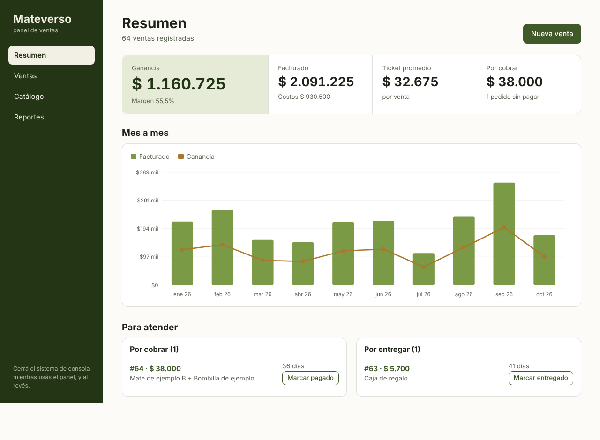

# Sistema de ventas Mateverso

[](https://github.com/JanezSersen07/sistema-pedidos-mateverso/actions/workflows/pruebas.yml)

Programa de consola en **C#** para llevar el registro de ventas de mi emprendimiento de mates ([Mateverso](https://mateverso.mitiendanube.com)). Nació como proyecto de la materia Programación y hoy lo uso en lugar de la planilla de Google Sheets.

## Qué hace

- Registra ventas: productos, costo (con bolsa, sticker y tarjeta), precio de venta, medio de pago, fecha y estado.
- Estados: **Pedido → Pagado → Entregado** (solo se avanza, no se retrocede).
- Calcula la **ganancia** y el margen de cada venta.
- Resumen por mes, por medio de pago, y totales: facturado, costos, ganancia, cobrado, por cobrar y por entregar.
- **Guarda todo en una base de datos SQLite** (`Documentos\Mateverso\mateverso.db`): ventas, detalle de productos y catálogo. Cada guardado es una transacción, así que un corte a mitad de camino no deja datos a medias.
- **Importa la planilla vieja** exportada como CSV, e informa las filas que hay que revisar a mano.
- **Busca y filtra** ventas por texto, rango de fechas, estado y medio de pago, y suma lo facturado y la ganancia de lo encontrado.
- **Corrige** una venta cargada con errores (con confirmación antes de guardar) y **elimina** ventas pidiendo escribir una palabra de seguridad.
- Exporta una copia en CSV que abre Excel o Google Sheets.
- **Catálogo de productos** con costo y precio: se agregan, editan y eliminan desde el menú. Al cargar una venta se eligen del catálogo (por número o por parte del nombre) y el programa completa el detalle, el costo y un precio sugerido.
- **Productos más vendidos**: unidades, facturado y ganancia por producto, ordenados por unidades o por ganancia.
- **Vincular ventas viejas al catálogo**: reconoce los productos del texto de cada venta anterior ("Imperial Negro + 2 x Bombilla"), los une con el catálogo y los ajusta a lo registrado, sin cambiar costos, precios ni ganancias, para que cuenten en los reportes por producto.
- **Reportes**: ganancia por mes con margen y variación contra el mes anterior, rentabilidad por producto (por unidades, ganancia o margen), lista de pendientes de cobro y de entrega (con los días de espera) y exportación a Excel.

## Conceptos de la materia que se usan

Clases y encapsulación (`private set`), propiedades calculadas, `enum`, `List<T>`, `Dictionary`, tipos que aceptan nulo (`DateTime?`), métodos estáticos, manejo de excepciones, validación de entradas y lectura/escritura de archivos.

## Estructura

| Archivo | Rol |
|---|---|
| `Venta.cs` | Modelo de una venta y sus cálculos |
| `ItemVenta.cs` | Un producto dentro de una venta, con cantidad y los valores del día |
| `Producto.cs` | Un producto del catálogo (nombre, costo, precio) |
| `CatalogoProductos.cs` | Lista de productos: agregar, buscar y eliminar |
| `BaseDatos.cs` | Abre la base SQLite y crea las tablas |
| `RepositorioSqlite.cs` | Lee y guarda ventas, items y productos en la base (con transacciones) |
| `Migracion.cs` | Pasa los CSV de versiones anteriores a la base, una sola vez y verificando |
| `ArchivoProductos.cs` | Lectura y escritura del catálogo en CSV (versiones anteriores) |
| `RegistroVentas.cs` | Lista de ventas, búsqueda, borrado y reportes |
| `FiltroVentas.cs` | Criterios de búsqueda (texto, fechas, estado, medio de pago) |
| `Vinculador.cs` | Reconoce productos en el texto de ventas viejas y arma su detalle |
| `Reportes.cs` | Cálculo de los reportes (por mes, por producto, pendientes) y exportación a CSV |
| `CopiasSeguridad.cs` | Copias de la base con fecha, poda de las viejas y restauración |
| `ArchivoVentas.cs` | Lectura y escritura de ventas en CSV (versiones anteriores y exportación) |
| `ImportadorPlanilla.cs` | Lectura tolerante de la planilla exportada |
| `LectorCsv.cs` | Lector/escritor de CSV (respeta comillas) |
| `PanelServicio.cs` | Todo lo que hace el panel web con los datos (listar, crear, avanzar estado, catálogo, reportes) y sus validaciones |
| `Formato.cs` | Montos en pesos (`$1.234`) |
| `EstadoVenta.cs`, `MedioPago.cs` | Enumeraciones |
| `Program.cs` | Menú de consola |
| `../SistemaPedidos.Web/` | Panel web: API (ASP.NET Core) + página (`wwwroot`) |
| `../SistemaPedidos.Tests/` | Pruebas automáticas (xUnit) |

## Cómo probarlo

1. Abrí `SistemaPedidos.slnx` en Visual Studio y ejecutá (F5).
2. Opción **6** e ingresá la ruta de `ejemplo-planilla.csv` para ver cómo importa.

## Catálogo y productos más vendidos

- Opción **11**: ver, agregar, editar y eliminar productos. Se guardan en la base de datos.
- Opción **2** (nueva venta): si hay productos en el catálogo, pregunta si querés cargarlos desde ahí. Se escribe el número o parte del nombre, y la cantidad. Si un producto no está, se puede cargar a mano solo para esa venta. El precio de venta se sugiere con la suma de precios y se puede cambiar (descuentos, combos).
- Cada venta guarda el **nombre, el costo y el precio del día** de cada producto. Si después cambia el catálogo o se borra un producto, las ventas anteriores no se modifican.
- Opción **12**: productos más vendidos. Solo cuenta las ventas cargadas desde el catálogo; las importadas de la planilla o escritas a mano no tienen detalle de productos.
- Los archivos de ventas anteriores siguen funcionando: el detalle de productos es una columna nueva y opcional.

### Vincular ventas viejas

Las ventas cargadas antes del catálogo (o importadas de la planilla) solo tienen un texto con los productos, así que no cuentan en los reportes por producto. La opción **11 > 5** las vincula:

- **Automático**: solo las ventas donde todos los nombres coinciden exacto con el catálogo (sin importar mayúsculas ni tildes).
- **Una por una**: si el nombre es parecido, propone el producto y se confirma con Enter; si no se reconoce, se elige del catálogo por número o buscando por texto. Se puede saltar una venta o terminar cuando se quiera.

Los costos y precios del catálogo de hoy se reparten proporcionalmente para que sumen exactamente lo que la venta ya tenía registrado (el costo sin bolsa, sticker ni tarjeta, y el precio de venta). Por eso el detalle de las ventas viejas es **estimado**, pero los totales y la ganancia de cada venta no cambian. Reconocer nombres y repartir los valores está en `Vinculador.cs`, con sus pruebas.

## Reportes

La opción **14** abre un menú de reportes:

1. **Ganancia por mes**: ventas, facturado, costos, ganancia y margen de cada mes, y cuánto subió o bajó la ganancia respecto del mes anterior (solo si ese mes anterior del calendario tuvo ganancia, para que el porcentaje tenga sentido).
2. **Rentabilidad por producto**: ordenada por unidades, ganancia o margen. Usa las ventas con detalle de productos.
3. **Pendientes**: ventas por cobrar y por entregar, las más viejas primero y con los días que llevan esperando.
4. **Exportar para Excel**: guarda los reportes en `Documentos\Mateverso\reportes` como CSV con punto y coma y coma decimal, para abrirlos directo en Excel o Google Sheets.

Los cálculos viven en `Reportes.cs`, separados de lo que se imprime en pantalla, y tienen sus pruebas en `ReportesTests.cs`.

## Base de datos

Desde la v8 los datos viven en **SQLite**, un solo archivo (`Documentos\Mateverso\mateverso.db`) que no necesita instalar ningún servidor. Se usa el paquete `Microsoft.Data.Sqlite`, que Visual Studio descarga solo.

| Tabla | Qué guarda |
|---|---|
| `ventas` | Una fila por venta: fecha, productos (texto), costos, precio, medio de pago, estado, nota |
| `items_venta` | El detalle de cada venta (producto, cantidad, costo y precio unitario), ligado a su venta con `ON DELETE CASCADE` |
| `productos` | El catálogo |

- Los **montos se guardan en centavos** (enteros) para evitar errores de redondeo.
- Cada guardado es una **transacción**: si algo falla a mitad de camino, la base queda como estaba.
- **Migración automática**: la primera vez que se abre el programa y todavía no existe `mateverso.db`, pasa los `ventas.csv` y `productos.csv` a la base. Arma la base en un archivo temporal, comprueba que tenga lo mismo que los CSV (cantidad de ventas, items y totales) y recién entonces la pone en su lugar. Los CSV quedan intactos, de respaldo, y no se vuelven a leer.
- La exportación a CSV (opciones 7 y 14 > 4) sigue funcionando para abrir los datos en Excel o Google Sheets.

## Panel web

Un panel para ver y cargar ventas desde el navegador, sobre la **misma base de datos** que usa la consola (`Documentos\Mateverso\mateverso.db`). Funciona solo en tu computadora (`localhost`); no sale a internet.

```
dotnet run --project SistemaPedidos.Web
```

Y abrí <http://localhost:5080>. Para cerrarlo, `Ctrl+C`.



- **Resumen**: ganancia, facturado, ticket promedio, gráfico mes a mes y lo que falta cobrar o entregar (con botón para avanzar el estado).
- **Ventas**: búsqueda y filtros, detalle de cada venta, alta con productos del catálogo (costo, precio y ganancia en vivo), edición y borrado.
- **Catálogo**: alta, edición y borrado de productos. Las ventas viejas conservan el costo y precio de su día.
- **Reportes**: por mes (con variación) y por producto, con descarga en CSV para Excel.
- **Copias**: copia manual, lista de copias guardadas, restauración (pide escribir `RESTAURAR` y resguarda antes lo actual) y descarga de todas las ventas en CSV.

Con esto el panel cubre todo lo que hacía la consola; la consola sigue funcionando para quien prefiera usarla.

Detalles de diseño: la API es un conjunto chico de rutas `/api/...`; las reglas viven en `PanelServicio` (sin dependencias web, por eso se prueba con xUnit); cada cambio hace la copia del día antes de guardar; el servidor rechaza pedidos que no vengan de `localhost` o de la propia página. **No uses la consola y el panel a la vez**: cada uno lee la base al momento, pero guardar desde los dos al mismo tiempo puede pisar cambios.

## Copias de seguridad

- Al guardar, el programa crea solo **una copia por día** de `mateverso.db` en `Documentos\Mateverso\copias` (ej.: `mateverso-2026-11-27.db`). Cada copia tiene las ventas y el catálogo juntos. Guarda las últimas 30 y borra las más viejas.
- Opción **13**: restaurar una copia. Antes de reemplazar nada comprueba que la copia se pueda leer, pide escribir `RESTAURAR` y resguarda el estado actual (`...-antes-de-restaurar-...`), así que restaurar también se puede deshacer.
- Si la copia falla por cualquier motivo, igual se guarda la venta.

## Pruebas automáticas

La carpeta `SistemaPedidos.Tests` tiene pruebas con xUnit que verifican el código sin usar el menú: cálculo de ganancias y márgenes, cambios de estado, filtros, catálogo, guardado y carga en la base SQLite (incluidos transacciones que fallan y montos con centavos), migración desde los CSV, importación de archivos viejos, copias de seguridad y las reglas del panel web (crear ventas, estados, catálogo, errores de datos).

- En Visual Studio: menú **Prueba > Ejecutar todas las pruebas**.
- En consola: `dotnet test SistemaPedidos.Tests`.

Las pruebas que escriben archivos o bases usan una carpeta temporal y no tocan tus datos reales.

## Privacidad

Los datos reales (ventas, costos) **no están en este repositorio**: se guardan localmente fuera del proyecto y el `.gitignore` los excluye. `ejemplo-planilla.csv` tiene datos inventados.

## Estado del proyecto

- [x] v1: pedidos en memoria
- [x] v2: ventas reales, archivo, importación y reportes
- [x] v3: búsqueda y filtros, corrección y borrado de ventas
- [x] v4: catálogo de productos con costos y reporte de productos más vendidos
- [x] v5: copias de seguridad automáticas con fecha y restauración desde el menú
- [x] Pruebas automáticas con xUnit
- [x] v6: reportes (por mes, por producto, pendientes) y exportación a Excel
- [x] v7: vincular ventas viejas al catálogo
- [x] v8: base de datos SQLite con migración automática desde los CSV
- [x] v9: panel web (API + página) sobre la misma base
- [x] v10: el panel suma edición de ventas, copias de seguridad y descargas para Excel
