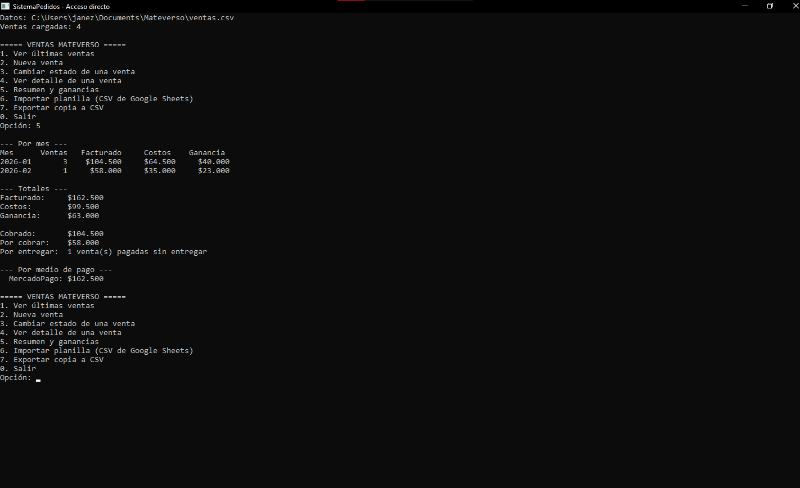

# Sistema de ventas Mateverso

Programa de consola en **C#** para llevar el registro de ventas de mi emprendimiento de mates ([Mateverso](https://mateverso.mitiendanube.com)). Nació como proyecto de la materia Programación y hoy lo uso en lugar de la planilla de Google Sheets.

## Qué hace

- Registra ventas: productos, costo (con bolsa, sticker y tarjeta), precio de venta, medio de pago, fecha y estado.
- Estados: **Pedido → Pagado → Entregado** (solo se avanza, no se retrocede).
- Calcula la **ganancia** y el margen de cada venta.
- Resumen por mes, por medio de pago, y totales: facturado, costos, ganancia, cobrado, por cobrar y por entregar.
- **Guarda todo en un archivo** (`Documentos\Mateverso\ventas.csv`), así los datos siguen cuando se cierra el programa.
- **Importa la planilla vieja** exportada como CSV, e informa las filas que hay que revisar a mano.
- Exporta una copia en CSV que abre Excel o Google Sheets.

## Conceptos de la materia que se usan

Clases y encapsulación (`private set`), propiedades calculadas, `enum`, `List<T>`, `Dictionary`, composición, métodos estáticos, manejo de excepciones y lectura/escritura de archivos.

## Estructura

| Archivo | Rol |
|---|---|
| `Venta.cs` | Modelo de una venta y sus cálculos |
| `RegistroVentas.cs` | Lista de ventas y reportes |
| `ArchivoVentas.cs` | Guardar y cargar el archivo propio del programa |
| `ImportadorPlanilla.cs` | Lectura tolerante de la planilla exportada |
| `LectorCsv.cs` | Lector/escritor de CSV (respeta comillas) |
| `Formato.cs` | Montos en pesos (`$1.234`) |
| `EstadoVenta.cs`, `MedioPago.cs` | Enumeraciones |
| `Program.cs` | Menú de consola |

## Cómo probarlo

1. Abrí `SistemaPedidos.slnx` en Visual Studio y ejecutá (F5).
2. Opción **6** e ingresá la ruta de `ejemplo-planilla.csv` para ver cómo importa.

## Privacidad

Los datos reales (ventas, costos) **no están en este repositorio**: se guardan localmente fuera del proyecto y el `.gitignore` los excluye. `ejemplo-planilla.csv` tiene datos inventados.

## Estado del proyecto

- [x] v1: pedidos en memoria
- [x] v2: ventas reales, archivo, importación y reportes
- [ ] Próximo: catálogo de productos con costos, productos más vendidos
